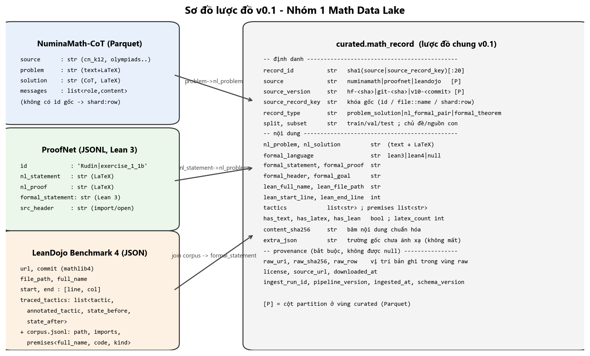
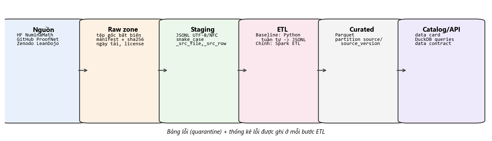

# Lược đồ chung v0.1 — `curated.math_record`

## 1. Nguyên tắc thiết kế

- **Một bảng rộng, một dòng = một đơn vị toán học** (một bài toán + lời giải, một cặp NL–formal, hoặc một định lý Lean). Các trường không áp dụng để `null`, không bịa giá trị.
- **Không mất thông tin:** trường gốc chưa ánh xạ được giữ trong `extra_json`; mọi bản ghi giữ con trỏ `raw_uri + raw_row + raw_sha256` để truy ngược về đúng dòng trong tệp raw bất biến.
- **Provenance là bắt buộc:** các trường `source`, `source_version`, `license`, `raw_uri`, `raw_sha256`, `ingest_run_id` không được `null` (vi phạm → bản ghi vào bảng lỗi).
- **Idempotent:** `record_id = sha1(source + "|" + source_record_key)[:20]`; khóa duy nhất ở curated là `(record_id, source_version)` → chạy lại cùng batch không nhân đôi.

## 2. Ánh xạ trường nguồn → lược đồ chung

| Cột chung | NuminaMath-CoT | ProofNet | LeanDojo Benchmark 4 |
|---|---|---|---|
| `source_record_key` | `split:shard:row` | `id` | `file_path::full_name` |
| `record_type` | `problem_solution` | `nl_formal_pair` | `formal_theorem` |
| `split` | train/test | valid/test | random split: train/val/test |
| `subset` | `source` (cn_k12…) | tên sách (phần trước `\|`) | 2 cấp module (`Mathlib.Algebra`) |
| `nl_problem` | `problem` | `nl_statement` | null |
| `nl_solution` | `solution` | `nl_proof` | null |
| `formal_language` | null | `lean3` | `lean4` |
| `formal_statement` | null | `formal_statement` | `code` của premise trùng tên trong corpus (phần trước `:=`) |
| `formal_proof` | null | null | tactic nối bằng xuống dòng |
| `formal_header` | null | `src_header` | `imports` của tệp trong corpus |
| `formal_goal` | null | null | `state_before` của tactic đầu |
| `lean_full_name`, `lean_file_path` | null | null | `full_name`, `file_path` |
| `lean_start_line`, `lean_end_line` | null | null | `start[0]`, `end[0]` |
| `tactics`, `premises` | [] | [] | danh sách tactic; tên premise từ `annotated_tactic` |
| `extra_json` | `messages` nếu khác problem/solution | — | split `novel_premises`, `url`, `commit` |

## 3. Kiểu dữ liệu và ràng buộc (bản nháp — chốt ở data contract tuần 2)

| Cột | Kiểu | Null? | Ràng buộc |
|---|---|---|---|
| `record_id` | string(20) | không | hex, duy nhất theo `(record_id, source_version)` |
| `source` | string | không | ∈ {numinamath, proofnet, leandojo} |
| `source_version` | string | không | khớp manifest |
| `record_type` | string | không | ∈ {problem_solution, nl_formal_pair, formal_theorem} |
| `nl_problem` | string | có | bắt buộc nếu `record_type ≠ formal_theorem` |
| `formal_statement` | string | có | bắt buộc nếu `record_type ≠ problem_solution` |
| `has_text/has_latex/has_lean` | bool | không | suy ra từ nội dung |
| `content_sha256` | string(64) | không | sha256 của nội dung chuẩn hóa NFC |
| `raw_uri`, `raw_sha256`, `raw_row` | string, string, int | không | `raw_sha256` khớp manifest |
| `license` | string | không | SPDX id |
| `schema_version` | string | không | "1.0" |

## 4. Câu hỏi mở cho tuần 2

1. Có tách bảng con `lean_tactic` (state_before/after đầy đủ) cho Nhóm 7 không? → v0.1: giữ trong raw, curated chỉ giữ danh sách tactic.
2. Mức partition: `source/source_version` hay thêm `subset`? → để thí nghiệm tuần 5 quyết định (rủi ro small-file).
3. Chuẩn hóa LaTeX (ví dụ `\dfrac` → `\frac`) có làm ở Nhóm 1 không? → Không; Nhóm 1 giữ nguyên văn, Nhóm 2 chuẩn hóa có kiểm soát.
