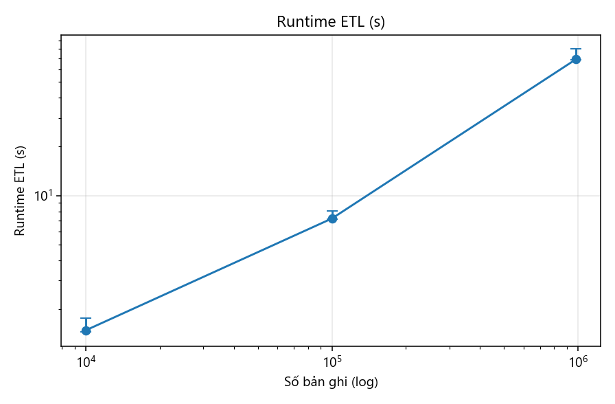
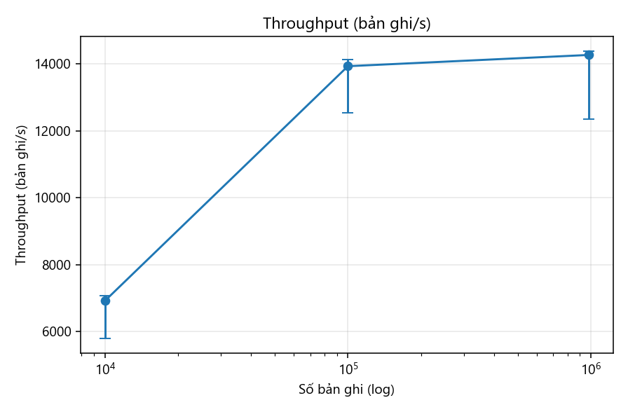
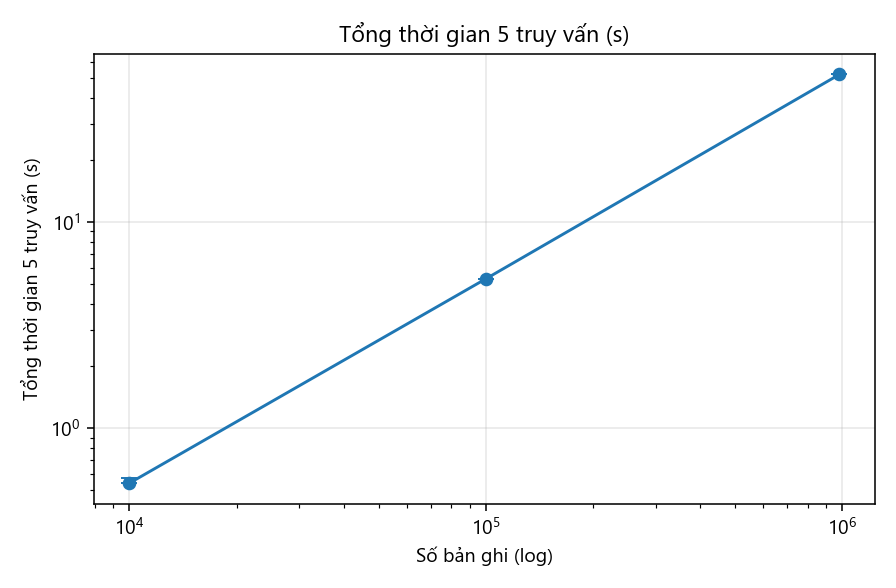

# Báo cáo tuần 3 — Baseline JSONL + Python tuần tự

**Nhóm 1 — Math Data Lake** · INT4418 Dữ liệu lớn

## 1. Nhiệm vụ và minh chứng

| Yêu cầu tuần 3 | Minh chứng | Trạng thái |
|---|---|---|
| Baseline chạy end-to-end | `src/mdl/baseline.py`, `scripts/chay_baseline.py` — raw → staging → curated JSONL | Xong |
| Raw timing | `results/raw/runs_baseline.jsonl` (9 lần chạy), `results/raw/runs_ingest.jsonl` (3 lần) | Xong |
| Báo cáo lỗi đọc | Mục 5 của báo cáo này; `results/raw/fault_injection.json` | Xong |

## 2. Thiết lập

- **Baseline (theo yêu cầu bắt buộc):** đầu vào JSONL thô (staging), một tiến trình Python đọc tuần tự từng dòng, ánh xạ sang `math_record`, kiểm tra lỗi, ghi **một tệp JSONL** không nén, không partition.
- **Mức quy mô:** 10K (8.428 NuminaMath + 1.201 LeanDojo + 371 ProofNet), 100K, toàn bộ 982.482 bản ghi. Mẫu phân tầng theo nguồn, chọn bằng `record_id` nhỏ nhất (tái lập). Bảng tra cứu corpus LeanDojo (180.973 premise) giữ nguyên ở mọi mức.
- **Lặp:** 3 lần mỗi mức, báo cáo median và min–max. Seed: không dùng ngẫu nhiên (chọn mẫu xác định). Timeout: 3.600 s.
- **Máy:** Intel i7-12700 (12 nhân/20 luồng), 23,8 GB RAM, SSD, Windows 11; Python 3.11.0, pyarrow 21.0.0, psutil 7.0.0.
- **Đo:** runtime (đồng hồ thực), peak RSS (lấy mẫu 100 ms), bytes đọc/ghi (bộ đếm I/O của tiến trình), dung lượng vào/ra.

## 3. Kết quả bước raw → staging (toàn bộ, 3 lần)

| Chỉ số | Median | Min–max |
|---|---|---|
| Runtime | 42,4 s | 42,2–67,0 s (lần đầu: bộ đệm đĩa lạnh) |
| Peak RSS | 1.505 MB | 1.465–1.506 MB |
| Bytes đọc / ghi | 2,06 GB / 1,91 GB | |

Peak RSS ~1,5 GB đến từ việc phải nạp trọn mảng JSON `random/train.json` (373 MB) của LeanDojo — đúng giả thuyết điểm nghẽn RAM ở tuần 2. Sau bước này mọi nguồn là JSONL đọc theo dòng.

## 4. Kết quả baseline staging → curated

| Mức | Bản ghi ra | Runtime median (min–max), s | Throughput median, bản ghi/s | Peak RSS, MB | Vào → ra | 5 truy vấn quét JSONL, s |
|---|---|---|---|---|---|---|
| 10K | 10.000 | 1,48 (1,45–1,76) | 6.922 | 187 | 99,8 MB → 24,8 MB | 0,54 |
| 100K | 100.000 | 7,23 (7,13–8,02) | 13.925 | 211 | 267 MB → 249 MB | 5,30 |
| Toàn bộ | 982.477 | 69,1 (68,5–79,7) | 14.261 | 416 | 1,91 GB → 2,45 GB | 51,96 |

**Nhận xét:**

1. Runtime tăng gần tuyến tính theo số bản ghi (×10 dữ liệu ⇒ ×4,9 rồi ×9,6 thời gian). Ở 10K, throughput thấp vì chi phí cố định ~1 s để nạp bảng corpus 180K premise chiếm phần lớn thời gian.
2. Throughput bão hòa ở ~14K bản ghi/s: baseline bị giới hạn bởi **một lõi CPU** (parse JSON + regex LaTeX), không phải I/O — máy có 20 luồng nhưng chỉ dùng 1.
3. Đầu ra JSONL **lớn hơn** đầu vào (2,45 GB so với 1,91 GB) do thêm provenance và cột dẫn xuất lặp lại trên mỗi dòng; JSONL không nén và không lưu theo cột.
4. Mỗi truy vấn đơn giản (đếm, lọc, tra cứu 20 ID) đều phải quét lại toàn bộ 2,45 GB: ~10 s/truy vấn ở mức toàn bộ, kể cả tra cứu điểm. Đây là điểm nghẽn mà định dạng cột + partition (tuần 5) cần giải quyết.
5. RAM baseline thấp (≤ 416 MB) vì đọc theo luồng; RAM chỉ cao ở bước nạp JSON mảng của LeanDojo.

## 5. Báo cáo lỗi đọc

### 5.1. Trên dữ liệu thật (toàn bộ 982.482 bản ghi)

| Loại | Số lượng | Chi tiết |
|---|---|---|
| Dòng không đọc được (E05) | 0 | |
| Lỗi cứng E03_EMPTY_CONTENT | **5** | 5 định lý LeanDojo có `full_name = null`: 4 trong `Mathlib/Tactic/DeprecateMe.lean` (dòng raw 14359, 33349, 39005, 84230), 1 trong `.lake/packages/batteries/Batteries/Util/ProofWanted.lean` (dòng 114462); đều không có tactic. |
| Tỷ lệ lỗi lược đồ | 5 / 982.482 = 0,0005% | |

Phát hiện: 4 bản ghi trong `DeprecateMe.lean` còn **trùng khóa** (`file_path::None`) ⇒ nếu không kiểm tra, chúng sẽ cùng `record_id` và ghi đè nhau. Chúng được giữ trong `errors.jsonl` kèm con trỏ raw để báo cho nguồn/nhóm sau.

Cờ chất lượng (không chặn): `W05_UNBALANCED_DOLLAR` 25.249 (chủ yếu ký hiệu tiền tệ trong NuminaMath), `W04_CONTROL_CHAR` 266, `W03_REPLACEMENT_CHAR` 5, `W01_EMPTY_NL_SOLUTION` 2 (ProofNet thiếu `nl_proof`).

### 5.2. Kiểm thử tiêm lỗi (mức 10K + 8 dòng hỏng)

| Trường hợp tiêm | Mã mong đợi | Phát hiện |
|---|---|---|
| JSON bị cắt cụt | E05_PARSE | ✓ |
| Byte không phải UTF-8 | E05_PARSE | ✓ |
| JSON không phải object | E05_PARSE | ✓ |
| `problem` rỗng | E03_EMPTY_CONTENT | ✓ |
| Nguồn không hợp lệ | E04_TRANSFORM | ✓ |
| Dòng lặp lại (trùng khóa) | E06_DUPLICATE_KEY | ✓ |
| `raw_uri` không có trong manifest | E01_MISSING_REQUIRED (raw_sha256) | ✓ |
| ProofNet thiếu `formal_statement` | E03_EMPTY_CONTENT | ✓ |

8/8 trường hợp được phát hiện, pipeline chạy hết, 10.000 bản ghi tốt vẫn ra đủ. Lỗi phát hiện trong quá trình làm: phiên bản đầu đọc tệp ở chế độ văn bản nên một byte sai UTF-8 làm dừng cả tệp; đã sửa sang đọc nhị phân và giải mã từng dòng.

## 6. Sự cố và tính hợp lệ của số đo

Lần chạy đầu tiên bị nhiễu: một extension IDE lập chỉ mục thư mục dữ liệu và chiếm ~23 GB RAM, máy bị đẩy sang bộ nhớ ảo (thời gian truy vấn đo được 112 s thay vì 52 s). Nhóm hủy toàn bộ lần đó (giữ tệp `runs_baseline_lan1_bi_nhieu_RAM.jsonl` để minh bạch), loại thư mục dữ liệu khỏi lập chỉ mục, bổ sung **chốt chặn bộ nhớ** (dừng nếu RSS > 3,5 GB hoặc RAM trống < 3 GB) rồi chạy lại cả 9 lần.

## 7. Kế hoạch tuần 4

Spark ETL đọc cùng staging, ánh xạ bằng biểu thức Spark gốc, ghi Parquet partition `source/source_version`; test parity với baseline trên từng cột; test lược đồ, idempotent và dòng hỏng; báo cáo tỷ lệ lỗi.
