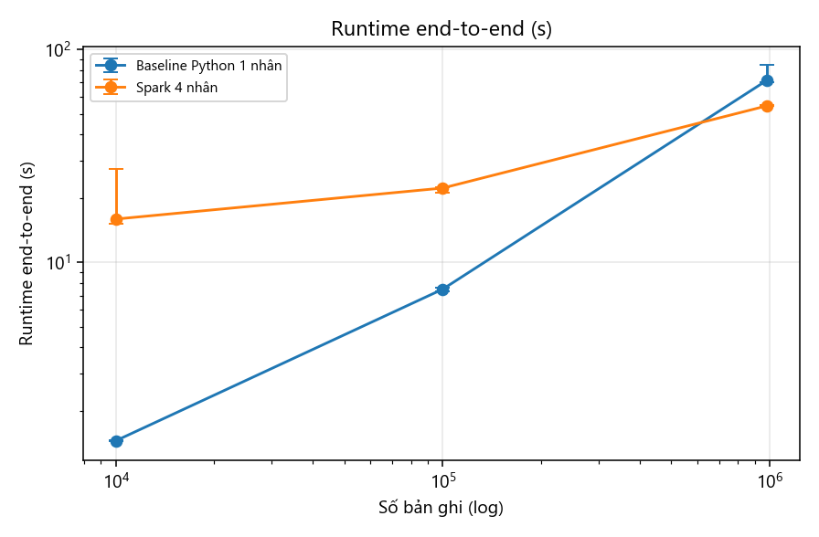
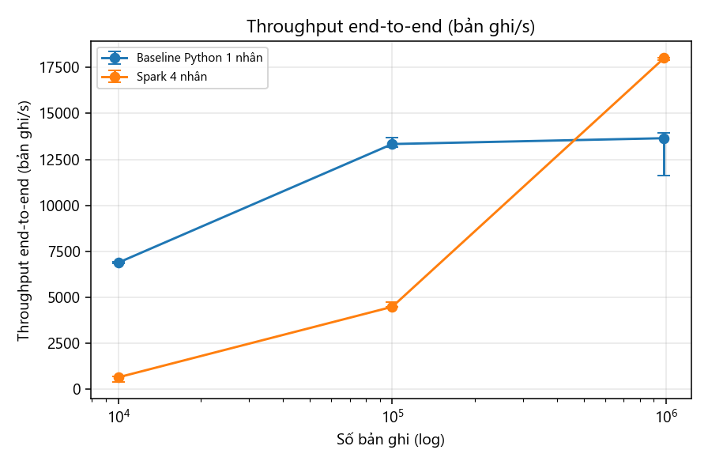

# Báo cáo tuần 4 — Spark ETL v0.1, kiểm thử lược đồ và tỷ lệ lỗi (checkpoint report)

**Nhóm 1 — Math Data Lake** · INT4418 Dữ liệu lớn

## 1. Nhiệm vụ và minh chứng

| Yêu cầu tuần 4 | Minh chứng | Trạng thái |
|---|---|---|
| Pipeline Spark v0.1 | `src/mdl/spark_etl.py`: staging JSONL → Parquet zstd, partition `source/source_version` | Xong |
| Chuẩn hóa text, LaTeX, Lean, metadata | NFC ở staging; đếm/gắn cờ LaTeX; tách phát biểu Lean theo mức ngoặc; provenance từ manifest | Xong |
| Kiểm thử lược đồ | 15 test (`tests/`), tất cả đạt — `results/raw/pytest_w4.txt` | Xong |
| Báo cáo tỷ lệ lỗi | Mục 5 | Xong |

## 2. Thiết kế Spark ETL

1. Đọc staging JSONL với **lược đồ khai báo trước** (không suy luận kiểu ⇒ không quét thêm một lần), chế độ `PERMISSIVE` để dòng hỏng vào cột `_corrupt_record` thay vì làm dừng job.
2. Ánh xạ từng nguồn sang `math_record` bằng **biểu thức Spark SQL gốc** (chạy trong JVM, không dùng UDF Python): `sha1`, `regexp_count`, `regexp_extract`, `transform`, `array_distinct`, `flatten`…
3. LeanDojo: join với corpus (premise → mã phát biểu, tệp → import); trùng khóa trong corpus được khử bằng `row_number` (giữ bản đầu, giống baseline).
4. Gắn provenance bằng broadcast join với manifest (19 dòng).
5. Kiểm tra lỗi cứng E01–E03 bằng biểu thức; **kiểm tra trùng khóa E06** chỉ xáo trộn 5 cột khóa nhỏ, rồi broadcast danh sách khóa trùng trở lại — tránh shuffle toàn bộ nội dung 3 GB.
6. Ghi Parquet zstd, `partitionBy(source, source_version)`, chế độ ghi đè **động theo partition** ⇒ chạy lại cùng batch không nhân đôi (đã kiểm bằng test).

## 3. Kiểm thử (15/15 đạt)

| Nhóm test | Nội dung |
|---|---|
| Lược đồ / contract | danh sách cột trong YAML contract = `schema.py`; bản ghi khớp lược đồ Arrow; provenance 100% khác null; `record_id` duy nhất và ổn định |
| Ánh xạ | `formal_language` đúng theo nguồn; join LeanDojo đủ; số tactic/premise nhất quán; tách phát biểu Lean (3 test); đếm LaTeX |
| Spark | **parity**: Spark = Python trên mọi cột của 997 bản ghi mẫu; **idempotent**: chạy 2 lần vẫn 997 bản ghi, không trùng; **dòng hỏng**: 2 dòng E05 + E03 + E06 được tách đúng, bản ghi tốt không bị ảnh hưởng |

**Parity trên toàn bộ dữ liệu** (`results/raw/parity_full.json`): so sánh hash từng bản ghi trên 36 cột giữa đầu ra baseline và Spark — 982.477 = 982.477 bản ghi, **0 khác biệt**, 0 bản ghi chỉ có ở một phía.

## 4. Sửa lỗi phát hiện trong tuần: tách phát biểu Lean

Kiểm tra tự động (ngoặc `()[]{}` phải cân bằng trong phát biểu) cho thấy heuristic v0.2 "cắt tại `:=` đầu tiên" sai ở **4.887/122.512 định lý (3,99%)**, do thuộc tính như `@[to_additive (attr := simp)]` chứa `:=`. Phiên bản v0.3:

- chỉ cắt tại `:=` ở **mức ngoặc 0** — dùng một regex nhóm nguyên tử (lồng tối đa 4 tầng) **chung cho Python và Java**, nên parity vẫn giữ nguyên;
- nếu không có `:=` ở mức 0 (corpus LeanDojo thường chỉ lưu phát biểu, không có chứng minh) thì giữ nguyên toàn bộ mã.

Kết quả: lệch ngoặc còn **1/122.512 (0,001%)**, trường hợp ngoặc nằm trong chuỗi ký tự. Chi phí: Spark mức toàn bộ chậm thêm 3,3 s (51,2 → 54,5 s; `results/tables/spark_v02_vs_v03.csv`).

## 5. Tỷ lệ lỗi (toàn bộ, pipeline v0.3, Spark và baseline giống nhau)

| Chỉ số | Giá trị |
|---|---|
| Bản ghi vào | 982.482 |
| Bản ghi curated | 982.477 (NuminaMath 859.594, LeanDojo 122.512, ProofNet 371) |
| Dòng không đọc được (E05) | 0 |
| Lỗi cứng | 5 (E03 — 5 định lý LeanDojo có `full_name = null`, xem báo cáo tuần 3) |
| **Tỷ lệ lỗi lược đồ** | **0,0005%** |
| Provenance đầy đủ | 100% bản ghi curated |
| Join LeanDojo ↔ corpus | 122.512/122.512 (W02 = 0) |
| Cảnh báo | W05 25.249 · W04 266 · W03 5 · W01 2 |

## 6. Hiệu năng Spark so với baseline (3 lần/mức, median và min–max)

Cùng máy, cùng staging, cùng mã ánh xạ v0.3. Spark: `local[4]`, driver 2 GB.

| Mức | Baseline runtime, s | Spark runtime, s | Throughput baseline / Spark (bản ghi/s) | Peak RSS baseline / Spark (MB) | Đầu ra baseline / Spark |
|---|---|---|---|---|---|
| 10K | 1,46 (1,45–1,46) | 16,0 (15,2–27,6) | 6.873 / 625 | 188 / 1.733 | 24,8 MB, 1 tệp / 5,0 MB, 11 tệp |
| 100K | 7,50 (7,32–7,59) | 22,4 (21,2–22,5) | 13.335 / 4.468 | 210 / 1.807 | 249 MB / 47,9 MB, 11 tệp |
| Toàn bộ | 72,0 (70,5–84,5) | **54,5 (54,4–54,8)** | 13.653 / **18.019** | 416 / 2.702 | 2,45 GB / **462 MB**, 19 tệp |

**Nhận xét (không tô đẹp kết quả):**

1. Ở 10K và 100K, Spark **chậm hơn** baseline 3–11 lần: chi phí cố định (lập lịch job, đọc lại toàn bộ corpus 180K premise để join, quét hai lần cho kiểm tra trùng khóa, ghi nhiều tệp) lấn át phần xử lý.
2. Chỉ ở mức toàn bộ Spark mới nhanh hơn: **1,32×** với 4 nhân — xa mức lý tưởng 4×. Giả thuyết: (a) đọc staging hai lần (kiểm tra trùng khóa), (b) parse JSON và regex LaTeX chiếm CPU, (c) chỉ 4 nhân do giới hạn RAM. Tuần 7–8 sẽ kiểm bằng ablation (tắt kiểm tra trùng, 2/4/8 nhân).
3. Lợi ích lớn và chắc chắn là **lưu trữ**: Parquet zstd nhỏ hơn JSONL **5,3 lần** (462 MB so với 2,45 GB).
4. Spark tốn RAM hơn (2,7 GB so với 0,4 GB) nhưng vẫn dưới giới hạn 3,5 GB của nhóm.
5. **Small-file problem đã xuất hiện**: ProofNet chỉ 371 bản ghi nhưng bị ghi thành 2 tệp 0,1 MB; LeanDojo có một tệp 0,4 MB; ở mức 10K có 11 tệp cho 5 MB. Đây là đầu vào cho thiết kế kích thước tệp ở tuần 5.

## 7. Checkpoint — tình trạng đường dữ liệu

- Baseline ổn định, có số đo sạch và lặp lại (biến thiên < 3% trừ một lần chạy lẻ).
- Spark ETL đúng (parity 100%) trước khi tối ưu — **không tối ưu khi baseline chưa ổn**, đúng yêu cầu.
- Rủi ro còn lại: tốc độ Spark ở quy mô nhỏ; số tệp nhỏ; cần cơ chế cập nhật gia tăng (tuần 6).

## 8. Kế hoạch tuần 5

So sánh ba (thực tế là năm) cấu hình lưu trữ: JSONL; Parquet không partition; Parquet partition `source/source_version`; partition sâu thêm theo `subset`; cố ý nhiều tệp nhỏ + compaction. Đo số tệp, dung lượng, thời gian ghi, thời gian đọc và 5 truy vấn kiểm tra bằng DuckDB.
