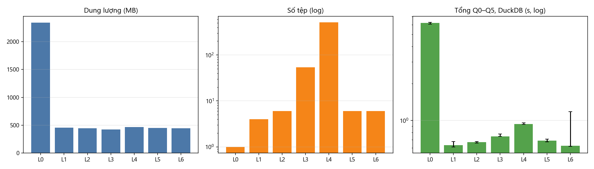
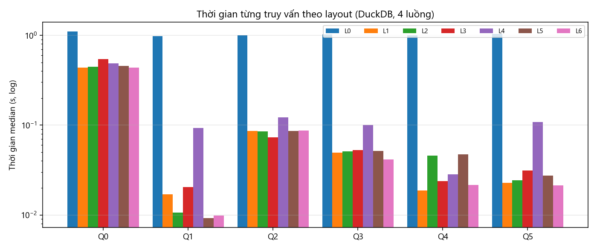

# Báo cáo tuần 5 — Thiết kế Parquet, partition, kích thước tệp và small-file problem

**Nhóm 1 — Math Data Lake** · INT4418 Dữ liệu lớn

## 1. Nhiệm vụ và minh chứng

| Yêu cầu tuần 5 | Minh chứng | Trạng thái |
|---|---|---|
| Thiết kế Parquet, partition, kích thước tệp | `src/mdl/storage.py` — 7 cấu hình L0–L6 | Xong |
| Xử lý small-file problem | `storage.compact()` + thí nghiệm L4 → L5; test `tests/test_storage.py` | Xong |
| Ba cấu hình lưu trữ; bảng số tệp, dung lượng, thời gian đọc | `results/tables/storage_layouts.csv`, `results/figures/w5_*.png` | Xong (7 cấu hình) |

## 2. Thiết lập thí nghiệm

- **Dữ liệu:** toàn bộ curated (982.477 bản ghi) sinh ở tuần 4. Mọi cấu hình chứa đúng cùng một tập bản ghi; số dòng của từng cấu hình được kiểm tra = 982.477.
- **Ghi:** Spark `local[4]`, driver 2 GB, Parquet nén zstd. **Đọc/truy vấn:** DuckDB 1.3.2, 4 luồng, giới hạn 2 GB RAM.
- **Truy vấn:** Q0 quét toàn bộ (đếm + tổng độ dài 2 cột văn bản lớn), Q1 đếm theo nguồn/split, Q2 lọc NuminaMath/olympiads có LaTeX, Q3 tra cứu 20 `record_id`, Q4 top-10 premise LeanDojo, Q5 kiểm tra provenance.
- **Đúng đắn:** kết quả 6 truy vấn của mọi cấu hình được so với L0 — **khớp 100%** (cột `results_match_L0` trong raw results). Truy vấn SQL cũng được test là cho cùng kết quả với bản Python (tuần 3).
- **Lặp:** truy vấn 3 lần/cấu hình (median, min–max); ghi 1 lần/cấu hình (thời gian ghi chỉ mang tính tham khảo — sẽ lặp ở tuần 7–8).

| Mã | Cấu hình |
|---|---|
| L0 | JSONL một tệp, không nén, không partition (đầu ra baseline) |
| L1 | Parquet, không partition, ~128 MB/tệp |
| L2 | Parquet, partition `source/source_version`, ~128 MB/tệp |
| L3 | Parquet, partition `source/source_version/subset` (54 thư mục) |
| L4 | Như L2 nhưng tối đa 2.000 bản ghi/tệp — mô phỏng nạp nhiều batch nhỏ (small files) |
| L5 | L4 sau khi chạy compaction |
| L6 | Như L2 nhưng row group 16 MB (thay vì 1 row group/tệp) |

## 3. Kết quả

| Cấu hình | Số tệp | Tệp < 8 MB | Dung lượng (MB) | Ghi (s) | Q0 quét toàn bộ (s) | Q1 (s) | Q4 (s) | Tổng Q0–Q5 median (min–max), s |
|---|---|---|---|---|---|---|---|---|
| L0 JSONL | 1 | — | 2.340,8 | — | 1,099 | 0,977 | 0,998 | 6,208 (6,066–6,274) |
| L1 flat | 4 | 0 | 454,4 | 41,3 | 0,434 | 0,017 | 0,019 | 0,629 (0,611–0,674) |
| L2 src/ver | 6 | 1 | 444,6 | 19,9 | 0,446 | 0,011 | 0,046 | 0,667 (0,658–0,675) |
| L3 +subset | 54 | 48 | 423,2 | 18,3 | 0,541 | 0,020 | 0,024 | 0,743 (0,742–0,775) |
| L4 tệp nhỏ | 512 | 512 | 465,1 | 60,4 | 0,485 | 0,093 | 0,028 | 0,936 (0,929–0,956) |
| L5 sau compaction | 6 | 1 | 450,1 | 19,3* | 0,453 | 0,009 | 0,047 | 0,685 (0,670–0,705) |
| **L6 src/ver + RG 16 MB** | 6 | 1 | 445,2 | 13,9 | 0,435 | 0,010 | **0,022** | **0,624** (0,617–1,184**) |

\* thời gian compaction 512 → 6 tệp. \** lần đầu đọc khi bộ đệm đĩa còn lạnh.

Đối chiếu: cùng 5 truy vấn Q1–Q5 bằng **Python quét JSONL tuần tự** (baseline tuần 4) mất **52,6 s**.

## 4. Phân tích

1. **Định dạng là yếu tố lớn nhất.** Parquet zstd nhỏ hơn JSONL **5,3 lần** (445 MB so với 2.341 MB) và truy vấn nhanh hơn **~10 lần** cùng engine DuckDB (0,62 s so với 6,2 s), **~85 lần** so với Python quét tuần tự (52,6 s). Truy vấn chỉ cần vài cột (Q1, Q5) nhanh hơn ~100 lần nhờ đọc theo cột.
2. **Small-file problem đo được:** cùng dữ liệu nhưng 512 tệp ~0,9 MB (L4) làm tổng thời gian truy vấn tăng **+50%** so với L2/L5; truy vấn metadata nhẹ bị ảnh hưởng nặng nhất (Q1 chậm ×9, Q5 ×4) vì chi phí mở tệp và đọc footer chiếm phần lớn thời gian. Ghi cũng chậm gấp 3 lần (60 s). **Compaction** (19 s) đưa 512 tệp về 6 tệp và khôi phục hiệu năng (0,685 s).
3. **Partition sâu hơn không luôn tốt hơn:** L3 (thêm `subset`) giúp Q2 lọc theo `subset` nhanh hơn ~14% nhờ tỉa thư mục, và nén tốt hơn ~5% vì dữ liệu cùng chủ đề nằm gần nhau. Nhưng nó tạo 48/54 tệp nhỏ và làm Q0, Q1, Q5 chậm hơn — không đáng với khối lượng hiện tại.
4. **Phát hiện ngoài dự kiến — row group:** ở L2, Q4 (lọc LeanDojo) chậm hơn L1 (0,046 s so với 0,019 s) dù được tỉa partition. Kiểm tra metadata: Spark ghi **1 row group/tệp**, nên toàn bộ LeanDojo chỉ là 1 row group và DuckDB đọc bằng 1 luồng; ở L1 LeanDojo trải trên 4 tệp. Giảm row group xuống 16 MB (L6) đưa Q4 về **0,022 s** mà dung lượng gần như không đổi.
5. **Partition hay không (L1 so với L2/L6):** tổng thời gian tương đương; lợi ích chính của partition theo `source/source_version` là **vận hành**: ghi đè/cập nhật một nguồn mà không đụng nguồn khác (cần cho cập nhật gia tăng tuần 6), và tỉa dữ liệu khi lọc theo nguồn. L1 phải ghi lại toàn bộ (41 s).

## 5. Quyết định thiết kế (áp dụng từ tuần 6)

- **Định dạng:** Parquet, nén zstd.
- **Partition:** `source / source_version` (không thêm `subset`).
- **Kích thước tệp mục tiêu:** ~128 MB; **row group 16 MB** (`parquet.block.size`) — đã đưa vào `run_spark_etl(row_group_mb=16)`.
- **Compaction:** chạy `storage.compact()` sau mỗi lần nạp gia tăng khi một partition có nhiều tệp hơn `ceil(dung lượng / 128 MB)`; thay thế kiểu hoán đổi thư mục để người đọc không thấy trạng thái dở dang.

## 6. Hạn chế

- Dữ liệu sau nén chỉ ~450 MB nên mọi truy vấn Parquet đều < 1 s; khác biệt giữa L1/L2/L6 nhỏ (vài chục ms), dễ bị nhiễu. Kết luận chắc chắn: JSONL so với Parquet và tệp nhỏ so với tệp đã gộp; các khác biệt nhỏ hơn cần thêm lần lặp ở tuần 7–8.
- Thời gian ghi chỉ đo 1 lần (bộ đệm đĩa ảnh hưởng: L6 ghi sau cùng nên nhanh nhất).
- Tra cứu điểm Q3 vẫn phải đọc toàn bộ cột `record_id` vì dữ liệu không sắp xếp theo khóa; sắp xếp theo `record_id` trong partition là ablation tuần 8.
