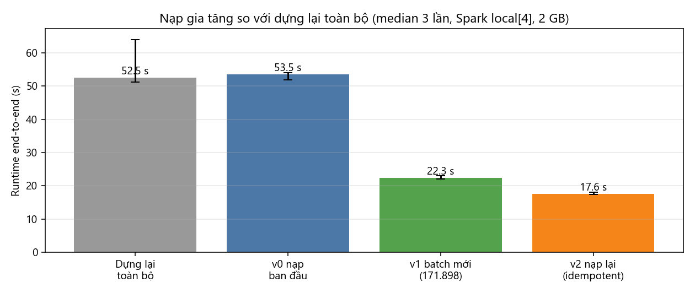

# Báo cáo tuần 6 — Provenance, catalog và cập nhật gia tăng

**Nhóm 1 — Math Data Lake** · INT4418 Dữ liệu lớn

## 1. Nhiệm vụ và minh chứng

| Yêu cầu tuần 6 | Minh chứng | Trạng thái |
|---|---|---|
| Bổ sung provenance | `src/mdl/provenance.py` — truy vết record → dòng raw; `results/raw/provenance_trace.json` (30/30) | Xong |
| Catalog | `src/mdl/catalog.py`; `catalog/catalog.json`, `catalog/catalog.md` | Xong |
| Cơ chế cập nhật gia tăng | `src/mdl/lake.py` (nạp batch, idempotent, xung đột, nhật ký `_lake_log`); minor compaction trong `storage.py` | Xong |
| Data card | `DataCard_v0.2.md` | Xong |
| Thử nghiệm thêm một batch dữ liệu mới | `scripts/chay_gia_tang.py`; `results/raw/runs_incremental.jsonl`; `results/tables/incremental.csv` | Xong (3 lần lặp) |

## 2. Provenance: truy vết ngược tới raw

Với mỗi `record_id`: tra `raw_uri, raw_row, raw_sha256` trong kho → tính lại sha256 tệp raw và so với manifest → đọc đúng bản ghi thứ `raw_row` (Parquet theo row group; JSONL theo dòng; mảng JSON LeanDojo **đọc theo luồng**, không nạp cả tệp 373 MB) → so nội dung gốc (sau NFC) với các cột curated.

Kết quả trên kho đầy đủ, 10 bản ghi/nguồn chọn bằng hash: **30/30 khớp** (sha256 đúng; NuminaMath: problem, solution, subset; ProofNet: id, nl_statement, formal_statement; LeanDojo: full_name, file_path, dòng bắt đầu, số tactic). Đây là bằng chứng trực tiếp cho câu hỏi nghiên cứu 1: hợp nhất 3 nguồn **không làm mất** khả năng truy về nguồn gốc.

## 3. Catalog

`catalog/catalog.md` (sinh tự động) mô tả: bảng `math_record` (982.477 bản ghi, 441,2 MB), 37 cột kèm kiểu/null/mô tả, 3 partition (nguồn, phiên bản, split, số bản ghi, số tệp, dung lượng, giấy phép), 19 tệp raw (sha256, ngày tải), **lịch sử nạp** đọc từ `_lake_log`, thống kê lỗi/cảnh báo theo nguồn, 5 truy vấn ví dụ cho các nhóm khác và 6 truy vấn kiểm tra.

## 4. Cập nhật gia tăng

**Quy tắc** (theo partition `source/source_version`):

| Tình huống | Hành động |
|---|---|
| `record_id` chưa có | thêm (tệp mới chuyển vào partition) |
| Có, cùng `content_sha256` | bỏ qua — chạy lại không nhân đôi |
| Có, khác `content_sha256` | **không ghi đè**, đưa vào `errors` với E07_CONTENT_CONFLICT |

Thứ tự an toàn: ETL batch ra thư mục tạm → chuyển tệp vào partition → ghi mục nhật ký **cuối cùng** (rename nguyên tử). Sau mỗi lần nạp chạy **minor compaction**: chỉ gộp các tệp < 32 MB, không ghi lại tệp lớn (khác compaction "major" ở tuần 5).

**Thí nghiệm (dữ liệu thật, 3 lần lặp):** batch mới = shard `train-00004` của NuminaMath (171.898 bản ghi).

| Bước | Mới | Không đổi | Xung đột | Tệp thêm | Runtime median (min–max), s | Compaction, s |
|---|---|---|---|---|---|---|
| Dựng lại toàn bộ (mốc) | 982.477 | — | — | 19 | 52,5 (51,2–64,0) | — |
| v0 nạp ban đầu (trừ shard 4) | 810.579 | 0 | 0 | 17 | 53,5 (51,9–54,0) | 3,8 |
| **v1 batch mới (shard 4)** | **171.898** | 0 | 0 | 5 | **22,3** (22,0–23,1) | 3,2 |
| v2 nạp lại cùng batch | 0 | 171.898 | 0 | 0 | 17,6 (17,4–18,1) | — |

**Kiểm chứng đúng đắn:** sau v2, kho có 982.477 bản ghi, 982.477 khóa phân biệt, và tập `(record_id, source_version, content_sha256)` **trùng hoàn toàn** với bản dựng lại toàn bộ (0 bản ghi chỉ có ở một phía) — cả 3 lần.

**Nhận xét:**

1. Nạp batch mới nhanh hơn dựng lại **2,4 lần** (22,3 s so với 52,5 s) và chỉ ghi 5 tệp mới; các partition khác không bị đụng tới (lợi ích trực tiếp của partition `source/source_version` đã chọn ở tuần 5).
2. Chi phí không tỉ lệ thuận: batch chiếm 17,5% dữ liệu nhưng tốn 42,5% thời gian của bản dựng lại, do chi phí cố định (khởi tạo job, đọc cột khóa của partition hiện có để đối chiếu, minor compaction 3,2 s).
3. Nạp lại vẫn tốn 17,6 s vì phải chạy ETL rồi mới biết là trùng. Cải tiến: lưu sha256 tệp staging trong nhật ký để bỏ qua batch đã nạp ngay từ đầu.
4. Test (`tests/test_lake.py`): sửa nội dung một bản ghi rồi nạp lại ⇒ 1 xung đột E07, kho **không thay đổi**.

## 5. Kiểm thử

20/20 test đạt (thêm 3 test: gia tăng = dựng lại + idempotent; xung đột nội dung bị chặn; catalog + truy vết provenance trên dữ liệu mẫu).

## 6. Hạn chế

- Không có giao dịch ACID: trong lúc minor compaction có khoảnh khắc ngắn cả tệp nhỏ cũ và tệp gộp cùng tồn tại; người đọc đồng thời có thể thấy bản ghi trùng. Iceberg/Delta Lake (snapshot isolation) là phần mở rộng phù hợp.
- Kịch bản "batch mới" dùng một shard có sẵn của cùng phiên bản nguồn; chưa thử snapshot nguồn mới thật (chưa có phiên bản NuminaMath/LeanDojo mới hơn được ghim).

## 7. Kế hoạch tuần 7

Chạy thí nghiệm quy mô 10K, 100K, 500K, toàn bộ cho baseline và Spark (2/4/8 nhân trong giới hạn RAM), lặp 3 lần; vẽ runtime, throughput, RAM, bytes I/O.
