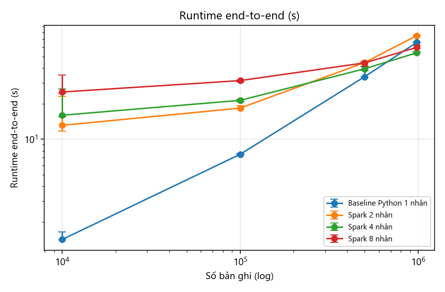
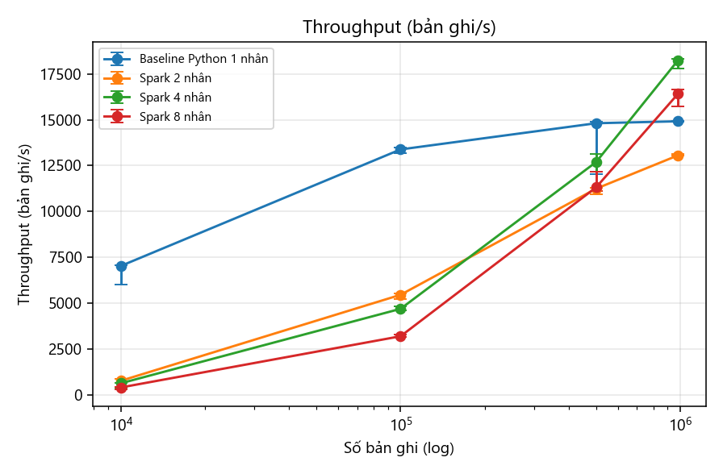
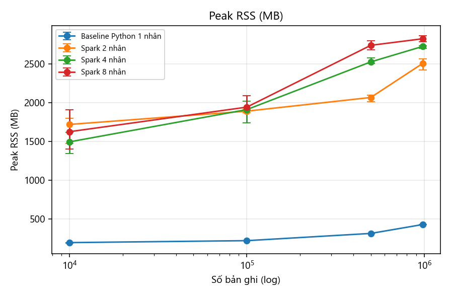
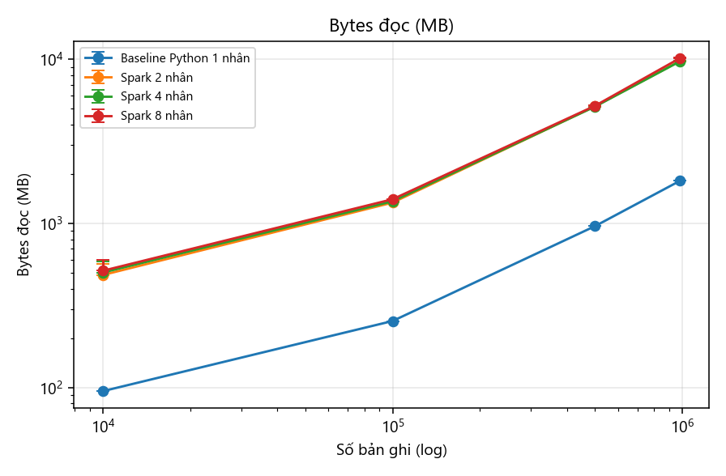

# Báo cáo tuần 7 — Thí nghiệm quy mô 10K, 100K, 500K và toàn bộ

**Nhóm 1 — Math Data Lake** · INT4418 Dữ liệu lớn

## 1. Nhiệm vụ và minh chứng

| Yêu cầu tuần 7 | Minh chứng | Trạng thái |
|---|---|---|
| Chạy 10K, 100K và toàn bộ; lặp ≥ 3 lần | 4 mức (thêm 500K) × 4 phương pháp × 3 lần = **48 lần chạy, 48 thành công** | Xong |
| CSV kết quả thô | `results/raw/w7_all_runs.csv` (mỗi dòng 1 lần chạy) + `results/raw/runs_*.jsonl` (đủ trường Phụ lục B) | Xong |
| Biểu đồ runtime, throughput, RAM, bytes I/O | `results/figures/w7_runtime.png`, `w7_throughput.png`, `w7_peak_rss.png`, `w7_read_mb.png`, `w7_write_mb.png`, `w7_query.png` | Xong |

## 2. Thiết lập

| Mục | Giá trị |
|---|---|
| Máy | Intel i7-12700 (12 nhân/20 luồng), 23,8 GB RAM, SSD NVMe, Windows 11 |
| Phần mềm | Python 3.11.0, PySpark 4.0.1, Java 21.0.8, DuckDB 1.3.2, pyarrow 21.0.0 |
| Giới hạn tài nguyên | Tổng RSS ≤ 3,5 GB/lần chạy (chốt chặn tự động); Spark driver 2 GB; DuckDB 2 GB, 4 luồng |
| Dữ liệu | staging cố định (data_version `manifest-…` trong raw results); mức 10K/100K/500K lấy mẫu phân tầng bằng `record_id` |
| Phương pháp | Baseline Python 1 nhân → 1 tệp JSONL; Spark `local[2|4|8]` → Parquet zstd, partition `source/source_version`, row group 16 MB |
| Đo | runtime end-to-end (gồm khởi tạo Spark), throughput = bản ghi vào / runtime, peak RSS (gồm JVM), bytes đọc/ghi từ bộ đếm I/O của hệ điều hành, thời gian bộ truy vấn Q0–Q5 |
| Lặp | 3 lần mỗi cấu hình; báo cáo median (min–max). Seed: không dùng (mẫu xác định). Timeout 3.600 s |

## 3. Kết quả

### 3.1. Runtime và throughput (median của 3 lần)

| Phương pháp | 10K | 100K | 500K | Toàn bộ (982K) | Throughput toàn bộ (bản ghi/s) |
|---|---|---|---|---|---|
| Baseline Python 1 nhân | 1,42 s | 7,47 s | 33,8 s | 65,8 s (65,7–65,9) | 14.921 |
| Spark 2 nhân | 13,1 s | 18,3 s | 44,5 s | 75,2 s (74,8–75,3) | 13.066 |
| Spark 4 nhân | 16,0 s | 21,3 s | 39,4 s | **53,8 s** (53,6–55,2) | **18.260** |
| Spark 8 nhân | 25,1 s | 31,3 s | 44,2 s | 59,8 s (59,1–62,4) | 16.431 |





### 3.2. Tài nguyên ở mức toàn bộ

| Phương pháp | Peak RSS (MB, max 3 lần) | Đọc (MB) | Ghi (MB) | Đầu ra (MB) | Số tệp ra |
|---|---|---|---|---|---|
| Baseline | 430 | 1.820 | 2.341 | 2.341 (JSONL) | 3 |
| Spark 2 nhân | 2.566 | 9.768 | 1.404 | 439 (Parquet) | 16 |
| Spark 4 nhân | 2.732 | 9.726 | 1.329 | 441 | 19 |
| Spark 8 nhân | 2.858 | 10.170 | 1.763 | 443 | 23 |





### 3.3. Truy vấn trên dữ liệu đã nạp

| Engine / định dạng | 10K | 100K | 500K | Toàn bộ |
|---|---|---|---|---|
| Python quét JSONL (Q1–Q5) | 0,55 s | 5,34 s | 26,7 s | 52,1 s |
| DuckDB trên JSONL (Q0–Q5) | 0,18 s | 0,85 s | 2,87 s | 5,28 s |
| DuckDB trên Parquet (Q0–Q5) | 0,03 s | 0,11 s | 0,36 s | **0,63 s** |


Đúng đắn: mọi lần chạy cho cùng số bản ghi ra (10.000 / 100.000 / 499.999 / 982.477 — mức 500K chứa 1 trong 5 bản ghi LeanDojo lỗi), tỷ lệ lỗi lược đồ ≤ 0,0005%.

## 4. Phân tích (trả lời RQ2)

1. **Chi phí cố định quyết định ở quy mô nhỏ.** Spark cần 13–25 s ngay cả với 10K bản ghi (khởi tạo job, đọc toàn bộ corpus 180K premise để join, quét hai lần, ghi nhiều tệp); baseline chỉ cần 1,4 s. Điểm hòa vốn của Spark 4 nhân nằm giữa 500K và toàn bộ dữ liệu.
2. **Spark không tăng tốc tuyến tính theo số nhân trên máy này.** Ở mức toàn bộ: 2 nhân 75 s, 4 nhân 54 s, 8 nhân **chậm lại** 60 s. Nguyên nhân chính là giới hạn heap 2 GB dùng chung cho mọi task trong `local` mode: 8 task mỗi task chỉ có ~250 MB, nên tăng GC và tràn đĩa — thấy rõ qua bytes ghi tăng từ 1,33 GB lên 1,76 GB.
3. **Khuếch đại I/O ~5×:** Spark đọc 9,7 GB cho 1,8 GB staging. Nguồn gốc dự kiến: (a) staging được quét 2 lần (lần thứ hai cho kiểm tra trùng khóa), (b) shuffle khi join corpus và kiểm trùng, (c) tràn đĩa do heap nhỏ. Tuần 8 tách riêng từng yếu tố bằng ablation.
4. **Baseline mở rộng tuyến tính và ổn định** (throughput ~14,9K bản ghi/s từ 500K trở lên, RAM < 430 MB) nhưng bị chặn ở 1 nhân. Với khối lượng ~1 triệu bản ghi trên 1 máy, baseline vẫn cạnh tranh về thời gian nạp.
5. **Lợi ích không thể tranh cãi nằm ở lưu trữ và truy vấn:** đầu ra Parquet nhỏ hơn 5,3 lần; truy vấn nhanh hơn **83 lần** so với Python quét JSONL và **8 lần** so với DuckDB trên JSONL (cùng engine) ở mức toàn bộ. Thời gian truy vấn tăng gần tuyến tính theo dữ liệu với cả 3 cách, nhưng hằng số của Parquet nhỏ hơn 1–2 bậc.
6. **Trade-off RAM:** Spark dùng 2,6–2,9 GB (gấp 6–7 lần baseline), sát giới hạn 3,5 GB của nhóm; đây là lý do không thể tăng heap để thử 8 nhân với 4 GB.

## 5. Mối đe dọa tính hợp lệ

- Một máy, `local` mode: không đo được chi phí mạng/shuffle phân tán thật; kết luận về số nhân chỉ đúng cho cấu hình RAM bị giới hạn.
- Bộ đệm đĩa của hệ điều hành ấm sau lần chạy đầu: lần đầu mỗi cấu hình thường chậm hơn (thấy ở max). Báo cáo median để giảm ảnh hưởng.
- Bytes I/O lấy từ bộ đếm của hệ điều hành cho tiến trình và các tiến trình con, bao gồm cả đọc thư viện JVM và tệp shuffle — là chỉ báo tổng, không phải bytes dữ liệu thuần.
- Mức 10K–500K là tập con của cùng snapshot, có cùng phân bố nguồn; chưa kiểm tra dữ liệu có phân bố khác (ví dụ nhiều Lean hơn).

## 6. Lệnh tái tạo

```
cd Tuan_07
../.venv/Scripts/python scripts/chay_baseline.py --scales 10k 100k 500k full --repeat 3 --sql
for c in 2 4 8: ../.venv/Scripts/python scripts/chay_spark.py --scales 10k 100k 500k full --repeat 3 --cores $c --queries --tag spark-c$c --out-name spark
../.venv/Scripts/python scripts/tong_hop_w7.py
```
