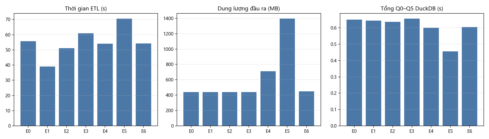
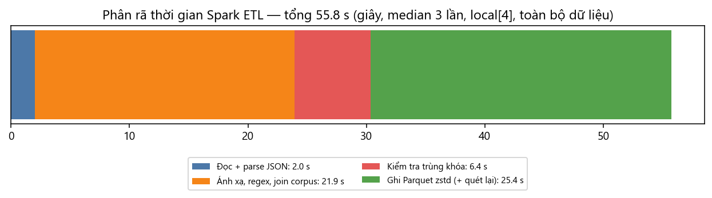

# Báo cáo tuần 8 — Ablation, phân tích điểm nghẽn và trường hợp lỗi

**Nhóm 1 — Math Data Lake** · INT4418 Dữ liệu lớn

## 1. Nhiệm vụ và minh chứng

| Yêu cầu tuần 8 | Minh chứng | Trạng thái |
|---|---|---|
| Ablation JSONL/Parquet, có/không partition, nhiều tệp nhỏ/tệp hợp lý | `results/tables/storage_ablation_x3.csv` (7 cấu hình × 3 lần ghi × 3 lần truy vấn) | Xong |
| Ablation thành phần pipeline | `results/tables/ablation.csv` (7 cấu hình × 3 lần, toàn bộ dữ liệu) | Xong |
| Phân tích điểm nghẽn | `results/tables/stage_breakdown.csv`, `results/figures/w8_stage_breakdown.png` | Xong |
| Phân tích trường hợp lỗi (taxonomy) | `results/tables/error_taxonomy.csv`, `results/raw/error_analysis.json` | Xong |
| Limitations | Mục 6 | Xong |

Thiết lập chung: toàn bộ dữ liệu (982.477 bản ghi curated), Spark `local[4]` driver 2 GB, DuckDB 4 luồng 2 GB, máy như tuần 7, mỗi cấu hình lặp 3 lần, báo cáo median (min–max).

## 2. Ablation lưu trữ: định dạng, partition, kích thước tệp

| Cấu hình | Số tệp | Dung lượng (MB) | Tổng Q0–Q5 (s) | Q1 metadata (s) | Q4 lọc LeanDojo (s) |
|---|---|---|---|---|---|
| L0 JSONL, 1 tệp | 1 | 2.340,8 | 6,57 (6,46–24,58*) | 1,065 | 1,055 |
| L1 Parquet, không partition | 4 | 454,3 | 0,611 (0,599–0,611) | 0,011 | 0,019 |
| L2 Parquet, partition nguồn/phiên bản | 6 | 446,1 | 0,692 (0,667–0,715) | 0,010 | 0,047 |
| L3 + partition `subset` | 54 | 424,1 | 0,736 (0,734–0,747) | 0,021 | 0,025 |
| L4 nhiều tệp nhỏ (2.000 bản ghi/tệp) | 512 | 465,1 | 0,936 (0,919–0,975) | 0,092 | 0,033 |
| L5 = L4 sau compaction | 6 | 450,9 | 0,622 (0,622–0,650) | 0,010 | 0,017 |
| **L6 = L2 + row group 16 MB (chọn)** | 6 | 446,7 | **0,610** (0,610–0,619) | 0,010 | 0,017 |

\* lần đầu đọc khi bộ đệm đĩa lạnh. Kết quả 6 truy vấn của **21/21** lần chạy Parquet khớp hoàn toàn với L0.

| Yếu tố bị loại bỏ (ablation) | Tác động đo được |
|---|---|
| Parquet → JSONL | dung lượng ×5,2; truy vấn ×10,8 chậm hơn (cùng DuckDB) |
| Tệp hợp lý → 512 tệp nhỏ | truy vấn +53% (Q1 ×9); compaction 512 → 6 tệp mất 28,5 s và khôi phục hoàn toàn |
| Partition nguồn/phiên bản → không partition | truy vấn tương đương (0,61 s), nhưng mất khả năng ghi đè/nạp gia tăng theo nguồn (tuần 6) |
| Partition vừa → partition sâu (`subset`) | 48/54 tệp < 8 MB, truy vấn +21%; dung lượng −5% |
| Row group 16 MB → 1 row group/tệp | Q4 chậm ×2,8 (1 luồng đọc partition LeanDojo) |

Lưu ý trung thực: thời gian **ghi** của L1/L2/L6 dao động mạnh theo thứ tự chạy và bộ đệm (L2 37–48 s, L6 11–14 s dù thao tác gần như giống nhau), nên nhóm **không** rút kết luận về tốc độ ghi giữa các cấu hình này; chỉ L4 (ghi tệp nhỏ chậm nhất ổn định 54–67 s) là đáng tin.

## 3. Ablation thành phần Spark ETL

| Cấu hình | ETL median (min–max), s | Δ so với E0 | Đọc (GB) | Ghi (GB) | Đầu ra (MB) | Tổng Q0–Q5 (s) | Q3 tra cứu điểm (s) |
|---|---|---|---|---|---|---|---|
| E0 mặc định | 55,8 (53,5–56,4) | — | 9,53 | 1,33 | 440,7 | 0,650 | 0,042 |
| E1 tắt kiểm tra trùng khóa | **39,1** (39,1–39,6) | **−29,8%** | **5,79** | 1,15 | 440,8 | 0,644 | 0,043 |
| E2 row group mặc định | 51,1 (51,0–52,3) | −8,3% | 9,46 | 1,26 | 440,3 | 0,637 | 0,042 |
| E3 split đầu vào 32 MB | 60,9 (60,3–61,1) | +9,3% | 9,51 | 1,30 | 440,9 (53 tệp) | 0,656 | 0,043 |
| E4 nén snappy | 54,1 (53,1–59,7) | −3,0% | 9,60 | 1,67 | 712,4 | 0,600 | 0,044 |
| E5 không nén | 70,5 (58,0–70,5) | +26,5% | 9,75 | 2,48 | 1.395,0 | **0,456** | 0,028 |
| E6 sắp xếp theo `record_id` | 54,2 (51,2–55,6) | −2,8% | 9,53 | 1,33 | 448,5 | 0,605 | **0,022** |

## 4. Phân tích điểm nghẽn

Phân rã bằng sink `noop` (chỉ tính toán, không ghi), median 3 lần:

| Giai đoạn | Giây | Tỷ lệ |
|---|---|---|
| Đọc + parse JSON staging (1,8 GB, có lược đồ khai báo) | 2,0 | 4% |
| Ánh xạ: regex LaTeX/`$`, sha1/sha256, tách phát biểu Lean, join corpus | 21,9 | 39% |
| Kiểm tra trùng khóa | 6,4 | 11% |
| Ghi Parquet zstd + quét lại phần còn thiếu | 25,4 | 46% |

**Kết luận về điểm nghẽn:**

1. **Không phải I/O đọc**: parse JSON chỉ chiếm 4%. Điểm nghẽn thật là **CPU cho biểu thức** (regex trên ~1,4 GB văn bản, băm) và **ghi + nén**.
2. **Kiểm tra trùng khóa đắt hơn phân rã cho thấy**: trong đường ghi thật, tắt nó tiết kiệm 16,6 s (−30%) và **3,7 GB đọc** — vì Spark phải quét lại toàn bộ staging cho nhánh khóa (không có cache trong giới hạn 2 GB). Đây là nguồn chính của khuếch đại I/O ~5× ghi nhận ở tuần 7. Trên dữ liệu hiện tại, kiểm tra này chỉ gắn E06 cho 3 bản ghi vốn đã lỗi E03. Hướng cải tiến: kiểm tra trùng **sau khi ghi** trên cột `record_id` của Parquet (đọc theo cột, rẻ), chỉ ghi lại partition nếu thực sự có trùng.
3. **Nén là đánh đổi rõ ràng**: không nén ⇒ dung lượng ×3,2, ghi chậm hơn 26% nhưng truy vấn nhanh hơn 30% (không tốn giải nén). Zstd là lựa chọn cân bằng cho kho chia sẻ; snappy nằm giữa.
4. **Sắp xếp theo `record_id`** làm tra cứu điểm nhanh ×1,9 (min/max của row group cho phép bỏ qua), chi phí +1,8% dung lượng và không làm chậm ETL — đáng đưa vào mặc định cho API tra cứu của tuần 10.
5. **Chia nhỏ split đầu vào (32 MB)** không giúp: thêm task, thêm tệp (53 tệp), chậm hơn 9%.

## 5. Phân tích trường hợp lỗi

### 5.1. Lỗi cứng (5 bản ghi, bị loại khỏi kho)

5 định lý LeanDojo có `full_name = null`: 4 trong `Mathlib/Tactic/DeprecateMe.lean` (dòng raw 14359, 33349, 39005, 84230) và 1 trong `.lake/packages/batteries/Batteries/Util/ProofWanted.lean` (dòng 114462). Đối chiếu corpus: cả hai tệp định nghĩa **cú pháp/lệnh** (ví dụ `def «proof_wanted» := leading_parser …`, `elabProofWanted`, `mkDeprecationStx`) chứ không phải định lý — LeanDojo trích nhầm các cú pháp này thành "định lý" không tên. 4 bản ghi đầu còn trùng khóa với nhau ⇒ Spark gắn thêm E06 cho 3 bản ghi sau.

### 5.2. Cảnh báo — phân loại theo nguyên nhân (quy tắc regex + kiểm tra ví dụ)

| Cờ | Nhóm nguyên nhân | Số bản ghi | % của cờ | Nguồn con chính |
|---|---|---|---|---|
| W05 (25.249) | Ký hiệu tiền tệ `$5`, `$ 1,200` | 23.972 | 94,9% | orca_math 17.892, synthetic_amc 2.152, gsm8k 1.539 |
| | Có `\$` thoát | 14.412 | 57,1% | orca_math 12.761 |
| | `$$` display lẻ | 843 | 3,3% | cn_k12, olympiads |
| | Không khớp quy tắc nào | 1.010 | 4,0% | (giá dạng biến `$d`, LaTeX hỏng) |
| W04 (266) | Byte 0x0C = ligature **fi** của font TeX OT1 (ví dụ `satisfi\x0ced`) | 160 | 60,2% | aops_forum 160 |
| | Byte 0x0B = ligature **ff** (`di\x0bfferent`) | 31 | 11,7% | aops_forum 31 |
| | Byte 0x08 do lỗi escape `\b`oxed | 1 | 0,4% | cn_k12 |
| | Ký tự điều khiển khác (ví dụ 0x14 trước `a_1`) | 97 | 36,5% | aops_forum 90 |
| W03 (5) | Mất mã hóa ký tự có dấu (`convexit�` thay vì *convexité*) | 5 | 100% | NuminaMath |

(Các nhóm có thể chồng lên nhau nên tổng % > 100%.)

**Nhận xét:**

- Cờ W05 có **≥ 95% dương tính giả** (ký hiệu tiền) ⇒ không dùng W05 làm bộ lọc; giữ làm tín hiệu cho Nhóm 2, chỉ ~1.010 bản ghi đáng kiểm tra thủ công.
- Giả thuyết ban đầu của nhóm "W04 do `\f`rac bị hiểu là ký tự form-feed" là **sai**: kiểm tra ví dụ cho thấy hầu hết đến từ **ligature font OT1 sót lại khi trích văn bản từ PDF** trong nguồn `aops_forum`. Cách sửa đúng là ánh xạ 0x0B→"ff", 0x0C→"fi" (việc chuẩn hóa có kiểm soát thuộc Nhóm 2; Nhóm 1 giữ nguyên văn và gắn cờ).
- **Trùng nội dung chính xác** (cùng `content_sha256`): NuminaMath 10.312 bản ghi trong 3.671 nhóm; LeanDojo 1.505 bản ghi trong 720 nhóm. Kiểm tra ví dụ: đây **không** phải bản sao thật mà là cùng một dòng mã phát biểu ngắn trong các namespace khác nhau (ví dụ `theorem coe_neg : ⇑(-f) = -f` cho `ZeroAtInftyContinuousMap`, `BoundedContinuousFunction`, …), 1.274/1.505 chứng minh term-mode nên không có tactic; vì `content_sha256` không gồm tên định lý nên chúng trùng băm. Khuyến nghị cho Nhóm 2: với Lean, khử trùng theo `(lean_full_name, content_sha256)` chứ không chỉ `content_sha256`.

## 6. Fairness/privacy và limitations

- **Privacy:** dữ liệu là bài toán công khai; một số đề AoPS chứa tên tác giả đề (người ra đề thi), không có dữ liệu cá nhân nhạy cảm. Không cần ẩn danh.
- **Cân bằng nguồn:** NuminaMath chiếm 87,5% ⇒ thống kê toàn kho bị chi phối bởi một nguồn; mọi thí nghiệm quy mô dùng mẫu phân tầng và luôn giữ đủ ProofNet.
- **Giới hạn phần cứng:** một máy, RAM bị chặn 4 GB ⇒ Spark chưa thể hiện được lợi thế phân tán; kết luận về số nhân/heap chỉ đúng trong cấu hình này.
- **Phân loại lỗi bằng quy tắc:** các nhóm nguyên nhân được xác định bằng regex rồi kiểm tra bằng mắt trên ví dụ, chưa có gán nhãn thủ công hai người.
- **Đo I/O:** bộ đếm I/O hệ điều hành gồm cả tệp shuffle và thư viện JVM.

## 7. Quyết định cho bản phát hành (tuần 9)

Giữ: Parquet zstd, partition `source/source_version`, row group 16 MB, minor compaction sau nạp. Thêm: sắp xếp theo `record_id` trong tệp. Ghi nhận cải tiến chưa làm: kiểm tra trùng khóa sau khi ghi để bỏ lần quét lại.
