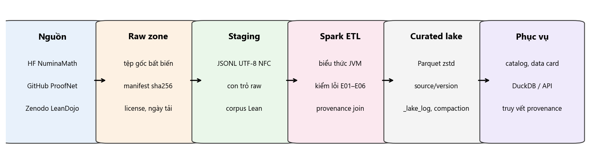

# Math Data Lake — Nhóm 1, INT4418 Dữ liệu lớn (bản 1.0.0-rc1)

Kho dữ liệu toán học đa nguồn — **NuminaMath-CoT** (văn bản + LaTeX), **ProofNet** (NL + Lean 3), **LeanDojo Benchmark 4** (Lean 4) — hợp nhất vào một lược đồ chung `math_record`, lưu dạng Parquet chia vùng, truy vấn được bằng DuckDB/Spark và **truy vết được tới từng dòng của tệp raw**.

## 1. Mục tiêu và câu hỏi nghiên cứu

- **RQ1:** Có thể hợp nhất văn bản, LaTeX và Lean vào một lược đồ chung mà không mất thông tin nguồn gốc? → 982.477 bản ghi, provenance đầy đủ 100%, truy vết 30/30 bản ghi mẫu về đúng dòng raw.
- **RQ2:** Định dạng lưu trữ và cách chia vùng ảnh hưởng thế nào tới thời gian, bộ nhớ, dung lượng khi dữ liệu tăng 10K → 100K → 500K → 982K? → Parquet nhỏ hơn JSONL 5,3×, truy vấn nhanh hơn 10× (cùng DuckDB) và 85× so với Python quét tuần tự; tệp nhỏ làm truy vấn chậm thêm 53%.

## 2. Kiến trúc



`raw` (tệp gốc bất biến + manifest sha256) → `staging` (JSONL NFC + con trỏ raw) → `Spark ETL` (biểu thức JVM, kiểm lỗi E01–E07) → `curated` (Parquet zstd, partition `source/source_version`, row group 16 MB, sắp xếp `record_id`, nhật ký `_lake_log`) → catalog, data card, DuckDB, truy vết provenance.

## 3. Cài đặt

Yêu cầu: Python 3.11, Java 17/21, ~5 GB đĩa cho dữ liệu đầy đủ (+ ~10 GB cho thí nghiệm), RAM ≥ 8 GB (mọi lần chạy bị chặn ≤ 3,5 GB).

```
python -m venv .venv
.venv/Scripts/pip install -r requirements.lock.txt      # Linux/macOS: .venv/bin/pip
```

Windows: đặt `winutils.exe` và `hadoop.dll` (Hadoop 3.4) vào `<storage>/hadoop/bin` — Spark cần để ghi tệp cục bộ.
Kho dữ liệu lớn: thư mục `_storage` gần nhất phía trên mã nguồn, hoặc đặt biến `MDL_STORAGE`.

## 4. Lệnh chạy nhanh (không cần dữ liệu đầy đủ)

```
python -m pytest -q tests                 # 20 test, ~2,5 phút, dùng data_sample/
python scripts/mdl.py sample              # tái tạo data_sample/curated bằng MỘT lệnh
python scripts/demo.py                    # demo end-to-end ~30 s: staging -> kho -> catalog -> truy vết
```

## 5. Dữ liệu đầy đủ

```
python scripts/mdl.py download            # tải 3 nguồn ghim phiên bản (2,14 GB) + manifest
python scripts/mdl.py verify              # kiểm sha256
python scripts/mdl.py staging             # raw -> staging (~45 s)
python scripts/mdl.py etl                 # Spark ETL -> <storage>/lake (~55 s, 4 nhân, 2 GB)
python scripts/mdl.py catalog             # docs/catalog/catalog.md
python scripts/mdl.py query "SELECT source, count(*) FROM math_record GROUP BY 1"
python scripts/mdl.py trace <record_id>   # truy vết về tệp raw
python scripts/mdl.py ingest <staging_batch>   # nạp gia tăng một batch
```

## 6. Tái tạo kết quả chính

| Kết quả | Lệnh | Raw results |
|---|---|---|
| Baseline + Spark 4 mức × 3 lần | `scripts/tao_scales.py`; `scripts/chay_baseline.py --scales 10k 100k 500k full --repeat 3 --sql`; `scripts/chay_spark.py ... --cores 2|4|8 --queries` | `results/raw/tuan_07/` |
| Parity Spark ↔ baseline toàn bộ | `scripts/kiem_tra_parity_full.py` | `results/raw/tuan_04/parity_full.json` |
| Cấu hình lưu trữ L0–L6 | `scripts/chay_luu_tru.py --repeat 1` (×3) | `results/raw/tuan_08/runs_storage_x3.jsonl` |
| Nạp gia tăng | `scripts/chay_gia_tang.py --repeat 3`; `scripts/tao_catalog.py` | `results/raw/tuan_06/` |
| Ablation + phân rã | `scripts/chay_ablation.py --repeat 3` | `results/raw/tuan_08/runs_ablation.jsonl` |
| Phân tích lỗi | `scripts/phan_tich_loi.py`, `scripts/kiem_tra_loi_doc.py` | `results/raw/tuan_08/error_analysis.json`, `tuan_03/fault_injection.json` |
| **Mọi hình/bảng của báo cáo** | `python scripts/tao_hinh_bao_cao.py` | → `results/figures/`, `results/tables/` |

Mỗi lần chạy ghi một dòng JSON theo Phụ lục B (run_id, timestamp, code version, data version, máy, phần mềm, tham số, seed/timeout, metric, trạng thái, log). Tham số từng thí nghiệm: `configs/experiments.yaml`.

## 7. Cấu trúc thư mục

```
src/mdl/          mã nguồn (config, manifest, readers, staging, schema, transform, spark_etl, storage, lake,
                  catalog, provenance, queries, sql_queries, baseline, scales, sample, runlog, report, __main__)
tests/            20 test (lược đồ, ánh xạ, parity, idempotent, dòng hỏng, compaction, nạp gia tăng, provenance)
configs/          experiments.yaml, query_ids.json, scales.json
data_sample/      raw mẫu 997 bản ghi (đúng định dạng gốc) + manifest + curated mẫu
manifest/         manifest + sha256 của snapshot đầy đủ
scripts/          tải, staging, thí nghiệm, phân tích, demo, CLI
results/raw/      kết quả thô theo tuần; results/figures, results/tables sinh bằng script
docs/             data card, system card, data contract v1.0, catalog, AI-use statement, privacy/license note
```

## 8. Giấy phép và ghi công

Dữ liệu: NuminaMath-CoT (Apache-2.0), ProofNet (MIT), LeanDojo Benchmark 4 (CC BY 2.0), mathlib4 (Apache-2.0) — xem `docs/privacy_license_note.md`. Việc sử dụng AI: `docs/ai_use_statement.md`.
