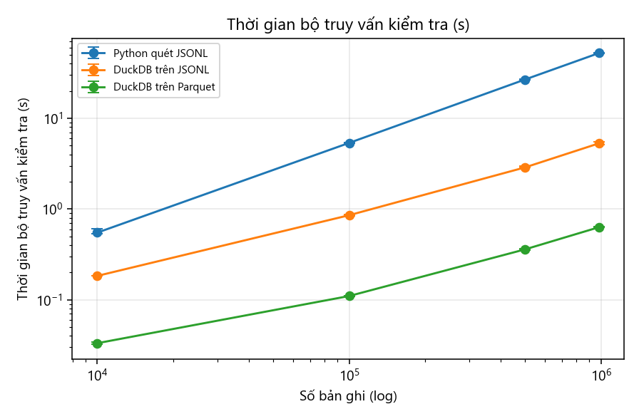
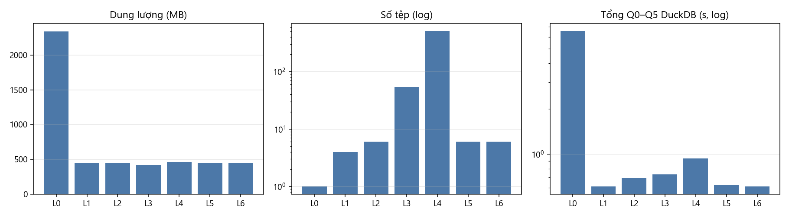
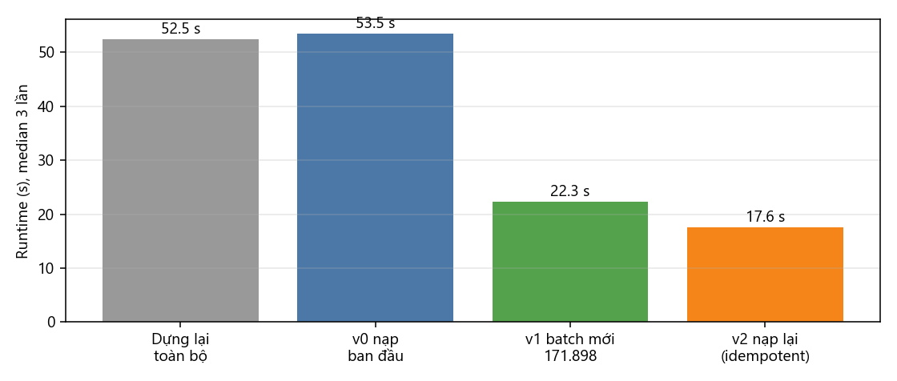
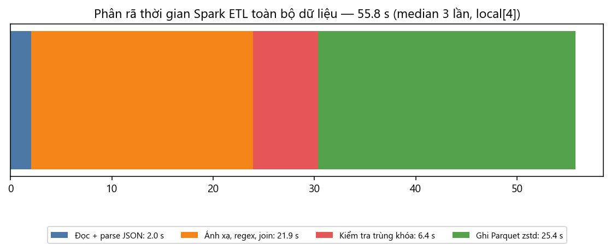

# Math Data Lake: Hợp nhất dữ liệu toán học đa biểu diễn với provenance cấp bản ghi và đánh giá chi phí lưu trữ ở quy mô một triệu bản ghi

**Nhóm 1 — INT4418 Dữ liệu lớn, Học viện Công nghệ Bưu chính Viễn thông** · Giảng viên: TS. Nguyễn Kiều Linh
Thành viên: TV1 … TV7 (xem `contributions.md`) · Bản 1.0.0-rc1

## Tóm tắt

Các hệ thống AI cho toán học cần dữ liệu từ nhiều nguồn với biểu diễn khác nhau: văn bản kèm LaTeX, phát biểu hình thức Lean 3 và Lean 4. Mỗi nguồn có định dạng, khóa và phiên bản riêng, khiến việc tái lập và truy vết khó khăn. Chúng tôi xây dựng **Math Data Lake**, hợp nhất NuminaMath-CoT, ProofNet và LeanDojo Benchmark 4 (982.482 bản ghi, 2,14 GB raw) vào một lược đồ 37 cột với provenance tới từng dòng raw. Pipeline gồm raw có manifest sha256, staging JSONL, Spark ETL bằng biểu thức JVM, và kho Parquet chia vùng có nhật ký nạp gia tăng. Kết quả: tỷ lệ lỗi lược đồ 0,0005%, provenance đầy đủ 100%, truy vết 30/30 bản ghi mẫu về đúng dòng raw, và đầu ra Spark khớp 100% với bản tham chiếu Python trên toàn bộ dữ liệu. Thí nghiệm ở 4 mức quy mô (10K–982K, 3 lần lặp, giới hạn 4 GB RAM) cho thấy định dạng cột là yếu tố quyết định: Parquet nhỏ hơn JSONL 5,3 lần, truy vấn nhanh hơn 10,8 lần (cùng DuckDB) và ~85 lần so với quét tuần tự. Ngược lại, Spark trên một máy chỉ nhanh hơn baseline Python 1,22 lần và không tăng tốc quá 4 nhân. Ablation chỉ ra điểm nghẽn thật là CPU cho biểu thức và việc quét lại dữ liệu để kiểm tra trùng khóa (30% thời gian), không phải I/O đọc.

## 1. Giới thiệu

Các bài toán AI4Math (truy hồi premise, autoformalization, sửa lỗi Lean, phân tích proof search, tutor) đều cần dữ liệu toán học lớn và đáng tin cậy. Dữ liệu sẵn có bị phân mảnh. NuminaMath-CoT [1] có ~860 nghìn bài văn bản + LaTeX nhưng không có ID gốc. ProofNet [2] có 371 cặp phát biểu tự nhiên – Lean 3. LeanDojo Benchmark 4 [3] có 122.517 định lý Lean 4 với tactic và premise, nhưng phát biểu nằm trong một corpus riêng. Mỗi nguồn dùng một định dạng khác: Parquet, JSONL, mảng JSON.

**Nút thắt Big Data** của đề tài là *đa dạng* (3 nguồn × 3 định dạng × 3 ngôn ngữ biểu diễn), *khối lượng* (~1 triệu bản ghi, tệp mảng JSON 373 MB phải nạp trọn vào RAM), *chi phí đọc–ghi* và *số lượng tệp* khi chia vùng, và *cập nhật gia tăng* khi có batch mới.

**Câu hỏi nghiên cứu.** RQ1: có thể hợp nhất ba biểu diễn vào một lược đồ chung mà không mất thông tin nguồn gốc không? RQ2: khi dữ liệu tăng 10K → 100K → toàn bộ, định dạng và cách chia vùng ảnh hưởng thế nào tới thời gian, bộ nhớ, dung lượng và thời gian truy vấn?

**Đóng góp:** (1) lược đồ `math_record` và data contract cho 7 nhóm tiêu thụ; (2) pipeline tái lập được, với provenance cấp bản ghi kiểm chứng ngược bằng sha256; (3) đánh giá định lượng định dạng/partition/kích thước tệp/số nhân trên ~1 triệu bản ghi, kèm ablation và phân tích lỗi trên dữ liệu thật.

## 2. Công trình liên quan

**Dữ liệu toán học.** NuminaMath [1] tổng hợp bài toán thi đấu và bài tập có lời giải chuỗi suy luận. ProofNet [2] là benchmark autoformalization bậc đại học (Lean 3). LeanDojo [3] trích xuất định lý, tactic và premise từ mathlib [4], kèm split `random` và `novel_premises`. Các công trình này phát hành dữ liệu riêng lẻ, không có lược đồ chung hay provenance xuyên nguồn.

**Lưu trữ phân tích.** Định dạng cột kiểu Dremel/Parquet [5] cho phép đọc chọn cột và nén hiệu quả. Spark [6] là engine xử lý phân tán phổ biến. Delta Lake [7] và kiến trúc lakehouse [8] bổ sung giao dịch ACID, nhật ký phiên bản và compaction lên tệp Parquet. Kho của chúng tôi tái hiện các ý tưởng tối giản (nhật ký nạp, idempotent, compaction) mà không cần ACID.

**Tài liệu hóa dữ liệu.** Datasheets for Datasets [9] đề xuất ghi động cơ, thành phần, thu thập, sử dụng; data card của nhóm theo khung này.

**Khoảng trống:** chưa có kho hợp nhất ba loại biểu diễn toán học với provenance kiểm chứng được và số liệu chi phí lưu trữ/truy vấn ở quy mô triệu bản ghi.

## 3. Dữ liệu

| Nguồn | Phiên bản ghim | Bản ghi | Định dạng raw | Giấy phép |
|---|---|---|---|---|
| NuminaMath-CoT | HF `9d8d210c` | 859.594 | 6 tệp Parquet, 1,23 GB | Apache-2.0 |
| ProofNet | Git `509ad797` | 371 | 2 tệp JSONL | MIT |
| LeanDojo Benchmark 4 | Zenodo v10, mathlib4 `29dcec07` | 122.517 (+ 180.973 premise) | mảng JSON + JSONL, 0,86 GB | CC BY 2.0 |

**Lược đồ** (37 cột): định danh (`record_id = sha1(source|key)[:20]`, `source`, `source_version`, `source_record_key`, `record_type`, `split`, `subset`); nội dung (`nl_problem`, `nl_solution`, `formal_language`, `formal_statement`, `formal_proof`, `formal_header`, `formal_goal`, cột Lean, `tactics`, `premises`); dẫn xuất (`has_latex`, `latex_count`, `content_sha256`, `quality_flags`, `extra_json`); provenance (`raw_uri`, `raw_row`, `raw_sha256`, `license`, `source_url`, `downloaded_at`, `ingest_run_id`, `pipeline_version`, `schema_version`).

**Split:** giữ nguyên split của nguồn (Nhóm 1 không chia lại). Mức quy mô 10K/100K/500K chọn phân tầng theo nguồn bằng `record_id` nhỏ nhất (xác định, tái lập); ProofNet luôn đủ 371.

**Chất lượng** (mục 7): 5 bản ghi lỗi; 4 loại cảnh báo. **Hạn chế:** NuminaMath chiếm 87,5%; ProofNet là Lean 3; 49,8% định lý LeanDojo không có tactic.

## 4. Phương pháp và kiến trúc


1. **Raw:** tải từ URL ghim phiên bản, ghi manifest (sha256, bytes, ngày tải, giấy phép).
2. **Staging:** reader cho từng định dạng chuyển sang JSONL một bản ghi/dòng, NFC, kèm con trỏ `(raw_uri, raw_row)`; cấu trúc lồng hỗn hợp kiểu của LeanDojo được đồng nhất. Mảng JSON chỉ nạp một lần ở đây; mọi bước sau đọc theo dòng.
3. **Ánh xạ:** bản tham chiếu Python (`transform.to_unified`) là đặc tả; Spark ETL hiện thực bằng biểu thức SQL. Hai bản dùng **cùng biểu thức chính quy**, kể cả regex tách phát biểu Lean tại `:=` ở mức ngoặc 0 (nhóm nguyên tử, lồng 4 tầng). Join corpus: khử trùng khóa bằng `row_number`; manifest được broadcast.
4. **Kiểm lỗi:** lỗi cứng E01–E06 bằng biểu thức. Kiểm tra trùng khóa chỉ shuffle 5 cột khóa rồi broadcast lại. Dòng hỏng vào `_corrupt_record`.
5. **Kho:** Parquet zstd, partition `source/source_version`, row group 16 MB, sắp xếp theo `record_id`. Nạp gia tăng: thêm bản ghi mới, bỏ qua bản ghi không đổi, từ chối thay đổi nội dung trong cùng phiên bản (E07); ghi nhật ký `_lake_log` sau cùng; minor compaction gộp tệp < 32 MB.
6. **Phục vụ:** catalog sinh tự động, truy vấn DuckDB, truy vết provenance (đọc lại đúng dòng raw, kiểm sha256 và nội dung).

**Độ phức tạp:** ETL là O(N) quét + O(N log N) cho shuffle khóa; truy vết một bản ghi là O(kích thước row group / vị trí trong mảng JSON).

## 5. Thiết lập thí nghiệm

| Mục | Giá trị |
|---|---|
| Máy | i7-12700 (12 nhân/20 luồng), 23,8 GB RAM, NVMe, Windows 11 |
| Phần mềm | Python 3.11.0, PySpark 4.0.1 (`local[n]`), Java 21, DuckDB 1.3.2, pyarrow 21.0.0 |
| Giới hạn | tổng RSS ≤ 3,5 GB (tự dừng), driver Spark 2 GB, DuckDB 2 GB/4 luồng |
| Baseline | JSONL staging → Python 1 tiến trình → 1 tệp JSONL (theo yêu cầu bắt buộc), cùng dữ liệu, máy, timeout |
| Quy mô | 10K, 100K, 500K, 982K; Spark 2/4/8 nhân |
| Metric chính | throughput ETL end-to-end; thời gian bộ truy vấn kiểm tra (Q0 quét toàn bộ, Q1 đếm, Q2 lọc, Q3 tra 20 ID, Q4 top premise, Q5 kiểm provenance) |
| Metric phụ | peak RSS, bytes đọc/ghi, dung lượng, số tệp, tỷ lệ lỗi lược đồ |
| Lặp | 3 lần/cấu hình, median (min–max); seed không dùng (mẫu xác định); timeout 3.600 s |

Mọi lần chạy ghi một bản ghi theo Phụ lục B; mọi hình sinh bằng `scripts/tao_hinh_bao_cao.py`.

## 6. Kết quả

### 6.1. RQ1 — hợp nhất không mất provenance

| Kiểm chứng | Kết quả |
|---|---|
| Bản ghi curated / vào | 982.477 / 982.482 (5 lỗi E03, nằm trong bảng errors kèm con trỏ raw) |
| Cột provenance khác null | 100% |
| Truy vết 30 bản ghi (10/nguồn) về raw: sha256 + nội dung | 30/30 khớp |
| Parity Spark ↔ Python (36 cột, toàn bộ) | 0 khác biệt |
| Join LeanDojo ↔ corpus | 122.512/122.512 |
| Nạp gia tăng ≡ dựng lại toàn bộ | trùng tập (record_id, version, content_sha256), 3/3 lần |

### 6.2. RQ2 — quy mô, định dạng, chia vùng

| Phương pháp | 10K | 100K | 500K | 982K | Throughput 982K | Peak RSS |
|---|---|---|---|---|---|---|
| Baseline Python 1 nhân | 1,4 s | 7,5 s | 33,8 s | 65,8 s | 14.921/s | 0,43 GB |
| Spark 2 nhân | 13,1 s | 18,3 s | 44,5 s | 75,2 s | 13.066/s | 2,57 GB |
| Spark 4 nhân | 16,0 s | 21,3 s | 39,4 s | **53,8 s** | **18.260/s** | 2,73 GB |
| Spark 8 nhân | 25,1 s | 31,3 s | 44,2 s | 59,8 s | 16.431/s | 2,86 GB |




Ở mức 982K, bộ truy vấn mất 52,1 s khi Python quét JSONL, 5,28 s với DuckDB trên JSONL và **0,63 s** với DuckDB trên Parquet.

| Cấu hình lưu trữ (982K, 3 lần) | Tệp | MB | Tổng Q0–Q5 (s) |
|---|---|---|---|
| L0 JSONL | 1 | 2.340,8 | 6,57 |
| L1 Parquet không partition | 4 | 454,3 | 0,611 |
| L2 partition nguồn/phiên bản | 6 | 446,1 | 0,692 |
| L3 + `subset` | 54 | 424,1 | 0,736 |
| L4 512 tệp nhỏ | 512 | 465,1 | 0,936 |
| L5 = L4 + compaction | 6 | 450,9 | 0,622 |
| L6 = L2 + row group 16 MB | 6 | 446,7 | **0,610** |



**Nạp gia tăng:** batch 171.898 bản ghi mất 22,3 s (dựng lại toàn bộ: 52,5 s); nạp lại cùng batch: 0 bản ghi mới (17,6 s).



### 6.3. Thảo luận trade-off

- **Định dạng là đòn bẩy lớn nhất**: ×5,3 dung lượng, ×10,8 truy vấn cùng engine — lợi ích này độc lập với số nhân.
- **Spark trên một máy với 2 GB heap là trade-off âm ở quy mô nhỏ**: chi phí cố định 13–25 s khiến baseline thắng tới ~500K. Ở 982K, Spark 4 nhân chỉ nhanh hơn 1,22 lần; 8 nhân chậm hơn 4 nhân vì heap dùng chung (ghi tăng 1,33 → 1,76 GB do tràn đĩa).
- **Partition** theo nguồn/phiên bản không làm truy vấn nhanh hơn ở quy mô này, nhưng cho phép nạp gia tăng chỉ đụng một partition (nhanh hơn 2,4 lần). Partition sâu hơn sinh tệp nhỏ và làm chậm.
- **Small files** làm truy vấn chậm 53% (Q1 ×9); compaction khắc phục hoàn toàn.

## 7. Ablation, phân tích lỗi và mối đe dọa tính hợp lệ



| Ablation (982K, Spark 4 nhân, 3 lần) | ETL | Đầu ra | Truy vấn |
|---|---|---|---|
| Mặc định | 55,8 s | 441 MB | 0,650 s |
| Tắt kiểm tra trùng khóa | **−29,8%**, đọc 9,5 → 5,8 GB | = | = |
| Không nén | +26,5% | ×3,2 | −30% |
| Snappy | −3% | ×1,6 | −8% |
| Sắp xếp theo `record_id` | ≈ | +1,8% | tra cứu điểm ×1,9 nhanh hơn |
| Split đầu vào 32 MB | +9,3% | 53 tệp | ≈ |

Điểm nghẽn: đọc + parse JSON chỉ chiếm 4% thời gian; ánh xạ (regex, băm, join) 39%; kiểm tra trùng khóa 11%; ghi + nén 46%. Kiểm tra trùng khóa buộc quét lại staging — nguồn chính của khuếch đại I/O ~5×.

**Phân tích lỗi trên dữ liệu thật:**

- 5 "định lý" LeanDojo không tên thực chất là định nghĩa cú pháp lệnh (`proof_wanted`, `DeprecateMe`).
- Cờ `$` lẻ có ≥ 95% dương tính giả do ký hiệu tiền tệ (orca_math).
- Ký tự điều khiển chủ yếu là mã ligature font TeX OT1 (0x0B = ff, 0x0C = fi) sót lại khi trích PDF trong aops_forum. Giả thuyết ban đầu của nhóm (lỗi escape `\f`) đã bị bác bỏ sau khi xem ví dụ.
- Heuristic tách phát biểu Lean phiên bản đầu cắt sai 3,99% định lý; phát hiện bằng kiểm tra cân bằng ngoặc và sửa còn 0,001%.

**Mối đe dọa tính hợp lệ:**

- Một máy, `local` mode, RAM bị chặn: không khái quát cho cụm thật.
- Bộ đệm đĩa ấm/lạnh làm biến động thời gian ghi; nhóm chỉ kết luận từ median và chỉ với khác biệt lớn.
- Bytes I/O đo bằng bộ đếm hệ điều hành, gồm cả thư viện JVM và tệp shuffle.
- Phân loại lỗi bằng regex và kiểm tra ví dụ, chưa có gán nhãn hai người.
- "Batch mới" là một shard của cùng phiên bản nguồn, chưa thử phiên bản nguồn mới thật.

## 8. Kết luận và hướng phát triển

Math Data Lake hợp nhất ~1 triệu bản ghi toán học đa biểu diễn với provenance kiểm chứng được và tỷ lệ lỗi 0,0005%. Các bằng chứng (parity toàn phần, truy vết raw, idempotent) trả lời khẳng định cho RQ1. Với RQ2, định dạng cột và kích thước tệp hợp lý quyết định chi phí lưu trữ và truy vấn. Spark chưa phát huy được trên một máy giới hạn RAM; baseline đơn giản vẫn cạnh tranh về thời gian nạp ở quy mô này.

**Sản phẩm:** kho Parquet + manifest, lược đồ và data contract v1.0, pipeline ingest/ETL, data card, bộ truy vấn kiểm tra, raw results + biểu đồ, README + demo, CLI.

**Hướng phát triển:**
- Kiểm tra trùng khóa sau khi ghi để bỏ lần quét lại.
- Bảng Iceberg/Delta cho giao dịch ACID.
- Thêm snapshot nguồn mới thật.
- Chạy trên cụm nhiều máy.
- Chuẩn hóa ligature OT1 phối hợp với Nhóm 2.

## Tài liệu tham khảo

1. J. Li et al. *NuminaMath*. Hugging Face dataset AI-MO/NuminaMath-CoT, 2024.
2. Z. Azerbayev et al. *ProofNet: Autoformalizing and Formally Proving Undergraduate-Level Mathematics*. arXiv:2302.12433, 2023.
3. K. Yang et al. *LeanDojo: Theorem Proving with Retrieval-Augmented Language Models*. NeurIPS Datasets and Benchmarks, 2023.
4. The mathlib Community. *The Lean Mathematical Library*. CPP 2020.
5. S. Melnik et al. *Dremel: Interactive Analysis of Web-Scale Datasets*. VLDB 2010.
6. M. Zaharia et al. *Apache Spark: A Unified Engine for Big Data Processing*. Communications of the ACM, 2016.
7. M. Armbrust et al. *Delta Lake: High-Performance ACID Table Storage over Cloud Object Stores*. VLDB 2020.
8. M. Armbrust et al. *Lakehouse: A New Generation of Open Platforms that Unify Data Warehousing and Advanced Analytics*. CIDR 2021.
9. T. Gebru et al. *Datasheets for Datasets*. Communications of the ACM, 2021.

## Phụ lục A — AI-use statement

Xem `docs/ai_use_statement.md`. Tóm tắt: mã nguồn và bản nháp tài liệu có sự hỗ trợ của Claude (Anthropic); mọi số liệu được sinh bằng script từ raw results; các sai sót do AI gây ra đã được phát hiện bằng test/kiểm tra dữ liệu và được liệt kê.

## Phụ lục B — Contribution statement

Xem `contributions.md` (vai trò chính/dự phòng, issue, phần bảo vệ của từng thành viên).

## Phụ lục C — Lệnh tái lập

```
python scripts/mdl.py download && python scripts/mdl.py staging && python scripts/tao_scales.py
python scripts/chay_baseline.py --scales 10k 100k 500k full --repeat 3 --sql
python scripts/chay_spark.py --scales 10k 100k 500k full --repeat 3 --cores 4 --queries
python scripts/chay_luu_tru.py --repeat 1      # ×3
python scripts/chay_gia_tang.py --repeat 3 && python scripts/tao_catalog.py
python scripts/chay_ablation.py --repeat 3 && python scripts/phan_tich_loi.py
python scripts/tao_hinh_bao_cao.py
```
