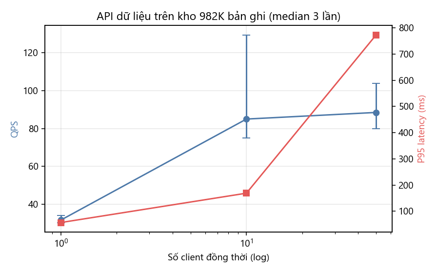

# Báo cáo tuần 10 — API dữ liệu cho nhóm khác, demo, bàn giao cuối

**Nhóm 1 — Math Data Lake** · INT4418 Dữ liệu lớn

## 1. Nhiệm vụ và minh chứng

| Yêu cầu tuần 10 | Minh chứng | Trạng thái |
|---|---|---|
| Tích hợp API dữ liệu cho nhóm khác | `math_data_lake/src/mdl/api.py`, `client.py`, `docs/api.md`; `python scripts/mdl.py serve` | Xong |
| Bản bàn giao cuối | `math_data_lake/` v1.0.0 (`CHANGELOG.md`), 25/25 test (`results/raw/tuan_10/pytest_final.txt`) | Xong |
| Video/demo | `scripts/demo.py` + `docs/kich_ban_demo.md` (7 phút) + slide `slides/BaoVe_Nhom1.pptx`; video do nhóm tự quay theo kịch bản | Kịch bản + slide xong; video nhóm quay |
| Bảng đóng góp cá nhân | `math_data_lake/contributions.md`, `docs/bo_cau_hoi_bao_ve.md` | Khung xong — nhóm điền tên, % đóng góp, link PR |

## 2. API dữ liệu

FastAPI + DuckDB đọc trực tiếp kho Parquet (982.477 bản ghi), một tiến trình, DuckDB 4 luồng/1 GB.

| Endpoint | Phục vụ |
|---|---|
| `/records/{id}`, `/records` (lọc + phân trang theo khóa, chọn cột) | tất cả nhóm |
| `/premises/{p}/theorems` | Nhóm 3, 4, 7 |
| `/pairs/nl-formal` | Nhóm 5, 6 |
| `/provenance/{id}` | Nhóm 2, kiểm toán |
| `/export` (Parquet/JSONL theo batch) | lấy dữ liệu hàng loạt |
| `/catalog`, `/stats`, `/health` | khám phá dữ liệu |

Bảo vệ đầu vào: regex cho `record_id`, miền giá trị cho `source`/`record_type`/`split`, danh sách cột hợp lệ, tham số SQL (test: ID sai dạng → 422, tên cột lạ → 400).

**Load test** (hỗn hợp 70% tra ID / 20% lọc / 10% tra premise, 1.500 request/mức, 3 lần, seed 42):

| Client | QPS median (min–max) | P50 | P95 | P99 | Lỗi | RSS server |
|---|---|---|---|---|---|---|
| 1 | 31,6 (30,3–34,0) | 28 ms | 57 ms | 62 ms | 0 | ≤ 480 MB |
| 10 | 85,0 (75,1–129,5) | 120 ms | 169 ms | 181 ms | 0 | ≤ 480 MB |
| 50 | 88,5 (79,9–103,9) | 569 ms | 773 ms | 881 ms | 0 | ≤ 483 MB |

Nhận xét: thông lượng bão hòa ~85–130 QPS từ 10 client (một tiến trình, mỗi tra cứu phải đọc metadata Parquet); với 50 client độ trễ tăng do xếp hàng. Thông lượng ở 10 client giảm qua 3 lần lặp (129,5 → 75,1) — chưa xác định nguyên nhân, nên báo cáo median kèm khoảng. Hướng cải tiến: nhiều worker, chỉ mục `record_id → tệp/row group` trong RAM, cache.

## 3. Bàn giao cuối

- **Mã:** `src/mdl` (18 module), CLI `scripts/mdl.py` (sample, download, verify, staging, etl, ingest, catalog, trace, query, serve).
- **Kiểm thử:** 25/25 đạt (lược đồ, ánh xạ, parity Spark ↔ Python, idempotent, dòng hỏng, compaction, SQL = Python, nạp gia tăng, xung đột, catalog, provenance, API).
- **Dữ liệu:** mẫu 997 bản ghi + manifest đầy đủ; tái tạo curated sample bằng `python scripts/mdl.py sample`.
- **Tài liệu:** README, data card v1.0, system card, data contract v1.0, API, catalog, AI-use statement, privacy/license note, kịch bản demo, bộ câu hỏi bảo vệ.
- **Kết quả:** raw results tuần 3–10, mọi hình/bảng sinh lại bằng `python scripts/tao_hinh_bao_cao.py`.
- **Báo cáo:** `report/BaoCao_BTL_Nhom1.{md,docx,pdf}` (9 trang); **slide:** `slides/BaoVe_Nhom1.pptx` (10 slide, có ghi chú người nói).

## 4. Đối chiếu tiêu chí nghiệm thu tối thiểu

| Tiêu chí (mục 11 hướng dẫn Nhóm 1) | Đáp ứng |
|---|---|
| Đọc được tối thiểu 3 nguồn | NuminaMath-CoT, ProofNet, LeanDojo Benchmark 4 (+ corpus) |
| Tái tạo được curated sample bằng một lệnh | `python scripts/mdl.py sample` (997 bản ghi, 0 lỗi) |
| Có baseline và ít nhất 3 mức quy mô | baseline JSONL + Python; 4 mức 10K/100K/500K/982K × 3 lần |
| Không mất trường nguồn/giấy phép/phiên bản | 9 cột provenance 100%; truy vết 30/30 |
| Một nhóm khác sử dụng được data contract | contract v1.0 + mock input + API + client; *cần xác nhận của nhóm tiêu thụ* |

## 5. Việc nhóm cần tự làm trước khi nộp

1. Điền họ tên, mã sinh viên, link issue/PR và % đóng góp vào `contributions.md`; thay TV1–TV7 trong báo cáo/slide.
2. Quay video demo 5–7 phút theo `docs/kich_ban_demo.md`.
3. Lấy xác nhận của ít nhất một nhóm tiêu thụ (Nhóm 2 hoặc 3/4) rằng đã đọc được mock input/API.
4. Đẩy mã lên Git của nhóm (`.gitignore` đã loại `_storage`, `.venv`); khi có Git, trường `git_commit` của các lần chạy mới sẽ là commit thật thay vì hash mã nguồn.
